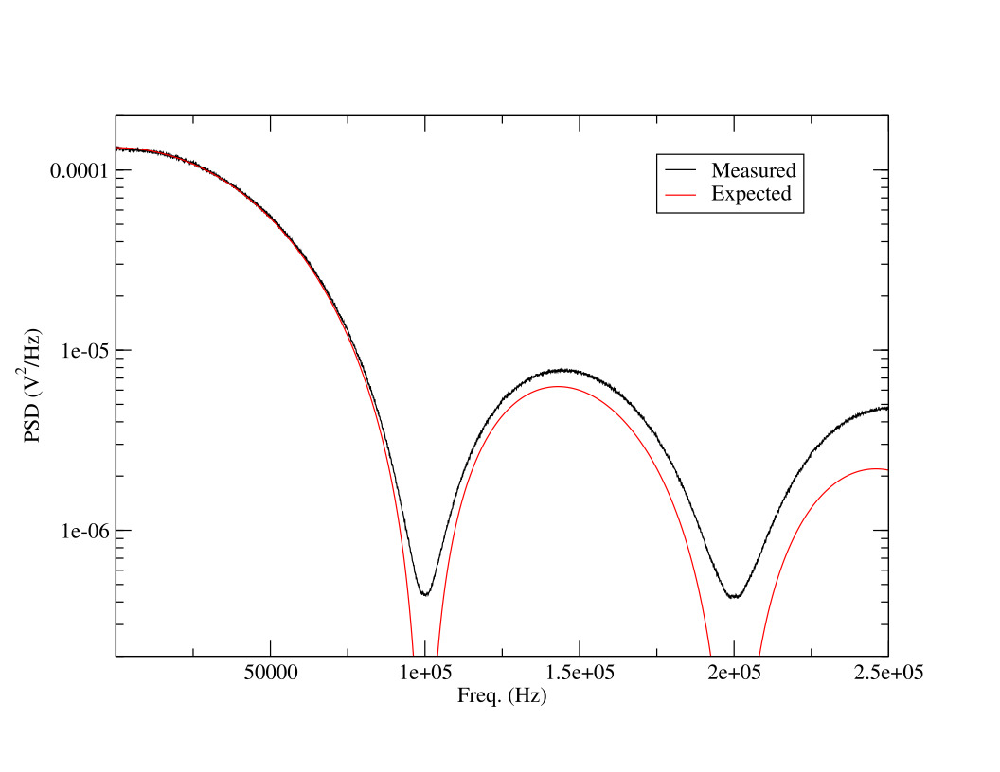
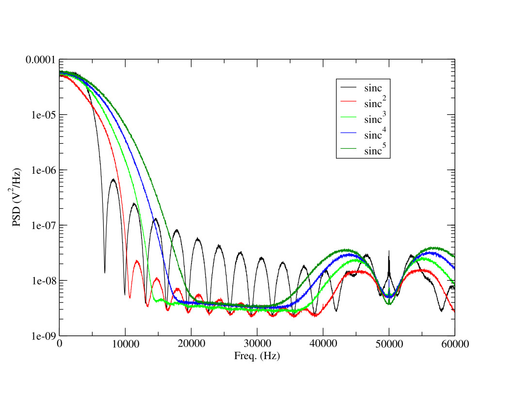
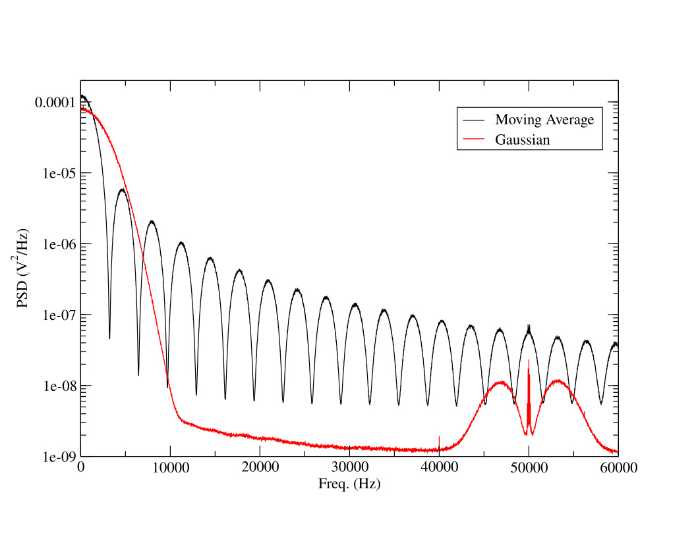

# Linear Feedback Shift Register

This program implements a Linear Feedback Shift Register (LFSR) with a period of 2^31^-1 i.e. &#8776; 2.147 x 10^9^ cycles.
At a clock frequency of 100 kHz it means a period of slightly less than 6 hours.

The stream of digital bits is available at pin D12. Few numerical digital filters (see below) with 31 coefficients are applied to the digital stream and the resulting values are converted to analog signals by the internal DAC and sent to the analog output pin A0. 

After reset the circuit starts with a default clock period of 10 &#956;s and the default digital filter set to Sinc.

## Input/Output Connections
 
| Name | Pin   | Description                               |
|------|-------|-------------------------------------------|
| A0   | J1 4  | Analog Output                             |
| D12  | J2 15 | Digital Output                            |
| D10  | J2 13 | ISR Monitor (High when executing the ISR) |

## Commands

| Command | Par. Type | Range       | Units   | Description       |
|---------|-----------|-------------|---------|-------------------|
| TS      | *uint*    | [10..10^6^] | &#956;s | Set clock period  |
| RS      | *none*    |             |         | Reset to defaults |
| S1      | *none*    |             |         | *Sinc* filter     |
| S2      | *none*    |             |         | *Sinc*^2^ filter  |
| S3      | *none*    |             |         | *Sinc*^3^ filter  |
| S4      | *none*    |             |         | *Sinc*^4^ filter  |
| S5      | *none*    |             |         | *Sinc*^5^ filter  |
| GA      | *none*    |             |         | Gaussian filter   |
| MA      | *none*    |             |         | Moving average    |

## Results
The measured PSD of the digital output is shown in Fig. 1. The theoretical *Sinc*^2^ curve fits very well the experimental points at least up to 80 kHz.
Fig. 2 shows the PSD of the analog signals obtained by filtering the digital stream of bits with a family of *Sinc*^n^ filters with n from 1 to 5. The corner frequency of the *Sinc* filter is 5 kHz.
Since the LFSR output is not limited to the Nyquist band the effect of aliasing is clearly visible just below and  above 50 kHz.

<figure>

<caption>Fig. 1 PSD of the digital output compared with the theoretical curve (red). Only a global vertical scaling factor has been used as a free parameter. The best value is  1.06 times the nominal one.</caption>
</figure>

<figure>

<caption>Fig. 2 PSD of the *sinc*^n^ filters.</caption>
</figure>

<figure>

<caption>Fig. 3 PSD of the moving average and the gaussian filters.</caption>
</figure>

